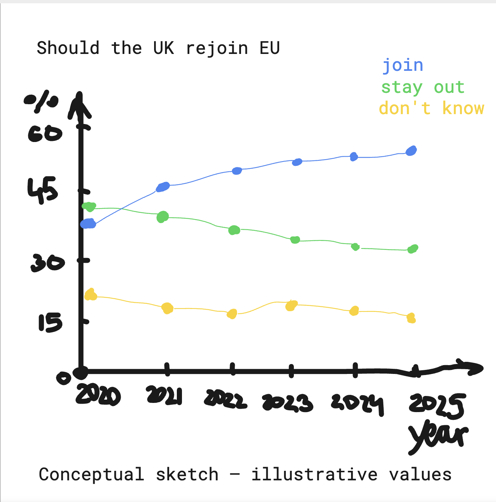

@import "../../lectures/css/datavis.less"

```elm {l=hidden}
import Tidy exposing (..)
import VegaLite exposing (..)
```

<!-- Everything above this line should probably be left untouched. -->

# Session 1: Practical Exercises

{(task|}

Use this document as a place to add your answers to the week's practical exercises.

{|task)}

## Q.2 Datavis Evaluation

1. Represents a complex dataset graphically that could not as effectively be represented via other means.
2. Often emphasises _connections_ and _comparisons_ between items of data.
3. Frequently involves _interaction_ to allow a user to influence what they see.
4. A _narrative_ supporting the construction of knowledge.
5. Generates an _aesthetic response_ in order to encourage users to engage with the data or question.

## Q.3 Bicycle Hires Visualization

```elm {l v}
bikehireBarchart : Spec
bikehireBarchart =
    let
        data =
            dataFromUrl "https://gicentre.github.io/data/bicycleHiresLondon.csv"

        enc =
            encoding
                << position X [ pName "Month", pTemporal ]
                << position Y [ pName "NumberOfHires", pQuant ]
    in
    toVegaLite [ width 640, data [], enc [], bar [] ]
```

## Q.4 Creating a Scatterplot

```elm {l v}
bikehireScatterplot : Spec
bikehireScatterplot =
    let
        data =
            dataFromUrl "https://gicentre.github.io/data/bicycleHiresLondon.csv"

        enc =
            encoding
                << position X [ pName "NumberOfHires", pQuant ]
                << position Y [ pName "AvHireTime", pQuant ]
    in
    toVegaLite [ width 640, data [], enc [], circle [] ]
```

## Q.5 Data Challenge

```elm {l v}
euPollsChart : Spec
euPollsChart =
    let
        data =
            dataFromUrl "https://gicentre.github.io/data/euPolls3.json"

        enc =
            encoding
                << position X [ pName "Date", pTemporal ]
                << position Y [ pName "Percent", pQuant ]
                << color [ mName "Answer", mNominal ]
                << tooltip
                    [ tName "Pollster"
                    , tName "Answer"
                    , tName "Percent"
                    ]
    in
    toVegaLite [ width 640, data [], enc [], circle [] ]
```

I choosed a catterplot. It shows how public opinion about joing the EU changed over time.
To see and compare the answers easily I used three diffenert colours: red for no answer/don't know, yellow for stay out and blue for join.
Overall, data shows that mostly join the EU support opininon is higher then staying out opininon.

## Q.6 Design Challenge


