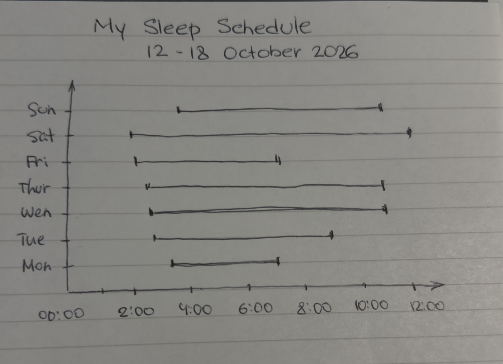

@import "../../lectures/css/datavis.less"

```elm {l=hidden}
import Tidy exposing (..)
import VegaLite exposing (..)
```

<!-- Everything above this line should probably be left untouched. -->

# Session 2: Practical Exercises

{(task|}

---

## 1. Evaluating Design Approaches

### 1.1. Jonathan Corum — Visualization Design

**1. What is a good number of design alternatives?**

I think 3-5 design alternatives would be fine. This is enough to compare them without spendigng too much time on developing ideas.

**2. Do you agree with Corum's statement about finding a clear thought?**

I agree with this statement. Visualization should have clear pupose and if main ideais not defined then to do the design may be complecated.

**3. Do you agree that visualization is not counting?**

I think values should do both depending on the task and user.

**4. Where do Corum's goals fit into Bloom's taxonomies?**

Corum approach relates to the cognitive domain. Understanding, analysing and evaluating information. Visualixation should help users to interpret data and make conclusions not only remember some values.

### 1.2. Data Humanism

**5. Sara Weber's Train Delay Scarf**

Yes, it is data visualization beacuse the colours represent information about train delays. Elements that embrace data humanism: connecting numeral data to a personal daily experience and turning it to a physical object. Feminist data visualisation elements: value of personal experience and alternative ways of representing data.

**6. Dear Data and Corum**

I think they are compatible. Dear Data shows patterns in everyday life and personal visualisation shows more individual experience and emotions.

### 1.3. Edward Tufte — Minimalism

**7. Data Ink and Chart Junk**

Data Ink represents actual values. Non data ink includes backgrounds, decorations.

**8. BBC Migration Graphic — Lie Factor**

lie factor = percentage change in circle area / percentage change in data

**9. Accessible Heat Lane Chart**

the chart follows tuftes priinciples by removing unnecessary borders

## 2. Creating a Minimalist Tufte Visualization

The visualizations are available in the following files:

- [IMDB Dataset](imdbRoot.md)
- [Default Histogram](defaultHistogram.md)
- [Minimalist Tufte Histogram and Evaluation](tufteHistogram.md)

## 3. Hand-Drawn Personal Visualization

### Where My Time Goes (7–19 October)



This visualization shows how much I slept for a period of time.

The visualization helped me notice when I go to sleep and when I wake up.

{|task)}
