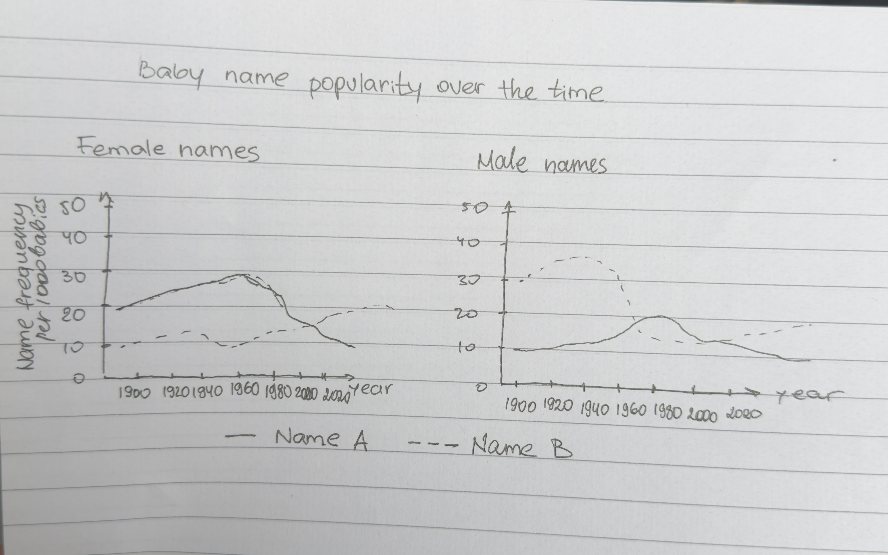

@import "../../lectures/css/datavis.less"

```elm {l=hidden}
import Tidy exposing (..)
import VegaLite exposing (..)
```

<!-- Everything above this line should probably be left untouched. -->

# Session 5: Practical Exercises

{(task|}

{(task|} Please complete the following exercises before next week. They should be added to your session05 folder of your portfolio. Remember to stage, commit and push your answers to github so I can see them. {|task)}

### 1. Measurement Types and Colour Schemes


Which measurement types (e.g. `Nominal`, `Ordinal`, `Quant`, `Temporal`) and which [colour schemes](https://vega.github.io/vega/docs/schemes/) (e.g. `category20`, `purples` etc.) would you specify for the following data. Briefly add your reasoning to the table below and then copy it to your exercises document in your coursework portfolio repo:

| Data                                                                                           | Measurement type | Colour Scheme  | Justification                                                                                                                           |
| ---------------------------------------------------------------------------------------------- | ---------------- | -------------- | --------------------------------------------------------------------------------------------------------------------------------------- |
| 1. Student cohorts in an attendance streamgraph                                                | Nominal          | dark2          | different categories and one of them is quantitably bigger based on its name                                                            |
| 2. FTSE 100 indices over the last 12 months                                                    | quantitative     | blues          | indexes are numerical, so sequential colour scheme can represent changes in magnitude                                                   |
| 3. Your assessment marks for all completed modules                                             | quantitative     | greens         | numerical values, so we can show the difference between low and hih marks                                                               |
| 4. Political party of elected MPs                                                              | nominal          | category10     | distinct categories without netural order, different hues helps distinguish them                                                        |
| 5. Responses to a 5-point [Likert](https://en.wikipedia.org/wiki/Likert_scale) survey question | ordinal          | redyellowgreen | natural order from strongly disagree to strongly agree. ordered diverging scheme can represent negative, neutral and positive responses |

### 2. Modifying the attendance streamgraph

Modify the attendance streamgraph provided near the top of these lecture notes so that it uses the colour scheme you've recommended in the question above. If your recommendation was the existing scheme, see if you can find a better scheme and briefly say how it is an improvement.

```elm {v l}
attendance : Spec
attendance =
    let
        cfg =
            configure
                << configuration (coView [ vicoStroke Nothing ])
                << configuration (coAxis [ axcoTicks False, axcoDomain False, axcoLabelAngle 0 ])

        data =
            dataFromUrl "https://gicentre.github.io/data/attendance.csv"
                -- Force session values to be treated as numbers not text
                [ parse [ ( "session", foNum ) ] ]

        enc =
            encoding
                << position X [ pName "session" ]
                << position Y
                    [ pName "attendance"
                    , pQuant
                    , pStack stCenter -- Stacked from the centre not bottom.
                    , pAxis []
                    ]
                << detail [ dName "id" ]
                << color
                    [ mName "cohort"
                    , mNominal
                    , mScale [ scScheme "dark2" [] ]
                    ]
    in
    toVegaLite
        [ width 600
        , height 300
        , cfg []
        , data
        , enc []
        , area
            [ maLine (lmMarker []) -- Add lines around each area 'stream'
            , maInterpolate miMonotone -- Monotone interpolation gives curved lines
            ]
        ]
```

I used dark2 scheme because undergraduate and postgraduate cohorts are nominal categories without natural order.

### 3. Global Temperature Data Challenge

The Economist famously used colour in its data visualization of global temperature anomalies on its [2019 cover](https://www.economist.com/leaders/2019/09/19/the-climate-issue?fsrc=scn/tw/te/bl/ed/theclimateissueawarmingworld). That is, the difference in mean global temperature compared to the 1950-1980 average.


How has colour been used here, and how effective do you think the design is? Are there any problems with this colour mapping?

Using a more [detailed version of the data](https://datahub.io/core/global-temp) containing monthly temperature anomaly values, here is a simple line chart.

```elm {l v}
temperatureBars : Spec
temperatureBars =
    let
        data =
            dataFromUrl "https://gicentre.github.io/data/temperatureAnomalies.json" []

        enc =
            encoding
                << position X [ pName "Date", pTemporal ]
                << position Y [ pName "Anomaly", pQuant ]
                << color [ mName "Anomaly", mQuant, mScale [ scScheme "blueorange" [], scDomain (doMid 0) ] ]
    in
    toVegaLite [ width 600, data, line [], enc [] ]
```

Modify the chart to make use of colour to emphasise the trends over time and possible seasonal cycles (the data are provided monthly since 1900). Consider the effect of changing the [line](https://package.elm-lang.org/packages/gicentre/elm-vegalite/latest/VegaLite#line) mark to a [bar](https://package.elm-lang.org/packages/gicentre/elm-vegalite/latest/VegaLite#bar) or other type of mark when exploring design possibilities.

Briefly add some text to your litvis document justifying your colour design choices.

### 4. Design Challenge


One way of developing your design skills is deliberately to constrain your design choices and see if you can come up with creative solutions under those constraints. Using this idea of [constrained creativity](https://www.fastcompany.com/3067925/how-constraints-force-your-brain-to-be-more-creative), try to come up with a design for showing gender and name frequency over time (as shown in [Baby Name Voyager](https://web.archive.org/web/20211015175350/https://www.babynamewizard.com/namevoyager-expert#prefix=&sw=both&exact=false) at the start of this lecture) that does not use colour (i.e. use only black or white in your design). For inspiration you may wish to have a look at the finalists in this [MonoCarto competition](https://somethingaboutmaps.wordpress.com/monocarto-2019-winners/).

Sketch out your design and include a photo of it in your `practicalExercises.md` portfolio document. As a reminder, you can include an image in a litvis document like this:

```markdown

```

---

_Check your progress._

- [ ] I can specify colours explicitly using decimal and hex RGB triplets.
- [ ] I can specify colours using HSL triplets.
- [ ] I can specify colours using explicitly named colours.
- [ ] I can identify _nominal_, _ordinal_, _quantitative_ and _temporal_ measurement types.
- [ ] I can match measurement type to an appropriate colour scheme.
- [ ] I can specify colour encodings that accommodate the most common forms of colour vision deficiencies.

{|task)}
